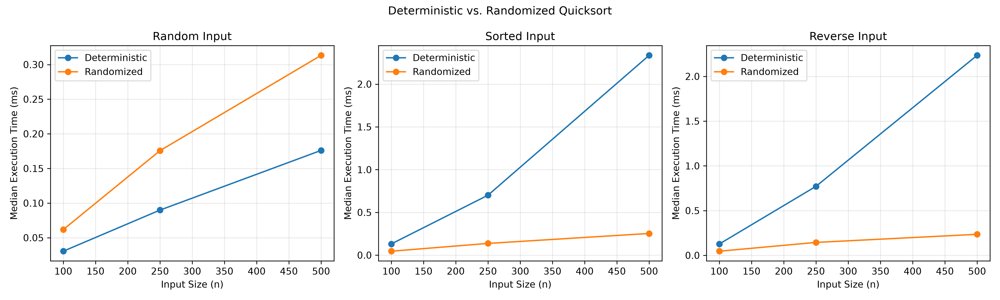

# Quicksort Algorithm: Implementation, Analysis, and Randomization

**Assignment 5**  
**Peter Nwochie Tiewah**  
University of the Cumberlands  
MSCS 532: Algorithms and Data Structures  
November 15, 2026

## Abstract

This report implements and evaluates deterministic first-element-pivot Quicksort and randomized-pivot Quicksort in Python. Both use recursive two-way partitioning and allocate new lists rather than partitioning in place. Correctness was checked against Python’s sorted() function on seven test inputs for each implementation. Execution time was measured across three input sizes (100, 250, and 500), three input distributions (random, sorted, and reverse-sorted), and seven repetitions per configuration. The deterministic implementation was faster on random inputs but much slower on presorted inputs. At 500 elements, randomized Quicksort was approximately 7.99 times faster on sorted data and 8.57 times faster on reverse-sorted data. The findings are consistent with first-element pivot selection producing quadratic worst-case behavior on monotonic input, while randomization reduces the likelihood of repeated extreme pivots. The results are implementation-specific and should not be generalized to all Quicksort variants.

## Introduction

Quicksort is a divide-and-conquer sorting algorithm that selects a pivot, partitions elements relative to that pivot, and recursively sorts the resulting partitions. Pivot selection determines how balanced the recursive subproblems become. This study compares a fixed pivot-selection rule with a randomized rule, evaluates their theoretical time and space requirements, and examines whether observed execution times align with those expectations.

## Implementation and Design

The deterministic implementation selects numbers[0] as its pivot, scans numbers[1:], and appends each remaining value to either smaller (value <= pivot) or larger (value > pivot). It returns quicksort(smaller) + [pivot] + quicksort(larger). The randomized implementation instead selects pivot_index = random.randrange(len(numbers)), takes the corresponding value as pivot, and uses enumerate(numbers) to skip exactly the chosen pivot occurrence before partitioning. Skipping by index rather than by value preserves duplicates. Both functions stop when len(numbers) <= 1, return ascending results, and do not mutate the caller’s input list. These are list-allocating teaching implementations, not in-place versions of Quicksort.

## Time Complexity: Best, Average, and Worst Cases

A partition of m elements requires Θ(m) time to examine and distribute the elements. When pivots split the input into roughly equal parts, the recurrence is T(n) = 2T(n/2) + Θ(n), resulting in Θ(n log n). This is the best-case order of growth and also the standard average-case order under uniformly random input permutations or randomized pivot selection. Balanced recursion has logarithmic depth, while the total partitioning work across any given level is linear in n. For consistently extreme pivots, the recurrence is T(n) = T(n − 1) + Θ(n). The total work is proportional to (n − 1) + (n − 2) + ... + 1 = n(n − 1)/2, or Θ(n²). With a first-element pivot, already sorted and reverse-sorted inputs trigger this unbalanced pattern. For randomized Quicksort, expected runtime is Θ(n log n) for any fixed input arrangement, but Θ(n²) remains possible for an unlucky sequence of pivot selections.

## Space Complexity and Implementation Overhead

The measured implementations make new lists for the left and right partitions and retain unfinished recursive calls. For approximately balanced partitions, peak auxiliary memory is O(n), as the active recursion path retains geometrically decreasing partition sizes, in addition to the output under construction. Across the entire execution, however, allocations summed over all balanced levels can total O(n log n); cumulative allocation is not the same as peak space. With severely unbalanced partitions, simultaneous live lists along a recursion chain can occupy O(n²) memory. Recursion depth is O(log n) when balanced and O(n) when unbalanced; Python may raise RecursionError for sufficiently large pathological inputs. Standard in-place partitioning can substantially reduce list allocation overhead. Random pivot selection also involves calls to the pseudo-random number generator and index-tracking work.

## Experimental Method

Both algorithms were tested in Python 3.15.2 on macOS 27.0.1 (arm64). Input sizes were n = 100, 250, and 500. Distributions included pseudorandom integers, already-sorted integers, and reverse-sorted integers. The dataset generator used seed 42, and each algorithm received equivalent input data for each size/distribution pair. Each configuration was run seven times; the median of elapsed wall-clock intervals measured with time.perf_counter() is reported in milliseconds. Correctness was validated by comparing output to sorted(numbers). Recursive debugging print statements were disabled for the reported benchmark. Random pivot selections were not separately seeded, and timing can vary with computer load, interpreter overhead, and system conditions.

## Results

Table 1 reports observed median execution times. Figure 1 shows the same results graphically. On random inputs, deterministic Quicksort measured faster for each tested size; at n = 500, it took 0.152375 ms versus 0.267292 ms for randomized Quicksort. On sorted input at n = 500, deterministic Quicksort took 1.934333 ms versus 0.242042 ms (approximately 7.99× longer). On reverse-sorted input at n = 500, it took 2.076167 ms versus 0.242292 ms (approximately 8.57× longer).

**Table 1. Median execution time (ms)**

| Distribution | n | Deterministic (ms) | Randomized (ms) |
|---|---:|---:|---:|
| Random | 100 | 0.022958 | 0.046792 |
| Random | 250 | 0.065250 | 0.122542 |
| Random | 500 | 0.152375 | 0.267292 |
| Sorted | 100 | 0.098959 | 0.040667 |
| Sorted | 250 | 0.519875 | 0.114250 |
| Sorted | 500 | 1.934333 | 0.242042 |
| Reverse | 100 | 0.102083 | 0.039000 |
| Reverse | 250 | 0.584292 | 0.113625 |
| Reverse | 500 | 2.076167 | 0.242292 |

*Figure 1. Median running time by distribution and input size.*

## Discussion

The first-element pivot is especially unfavorable for sorted and reverse-sorted arrays because it repeatedly yields one empty partition and one partition containing nearly all remaining elements. This explains the steep growth observed for deterministic Quicksort in those conditions. Randomization makes repeated extreme pivot choices much less likely and produced substantially better observed results on these structured datasets. Nevertheless, selecting pivots randomly incurs overhead, and the deterministic approach was faster on random input in this particular experiment. Thus, randomization is best interpreted as improving performance robustness rather than guaranteeing a lower elapsed time in every run. The observed curves support the theoretical predictions but, given just three small input sizes and noisy time measurements, cannot independently establish asymptotic bounds.

## Limitations

The benchmark examines only three sizes up to 500 and a single generated dataset per input-size/distribution combination. Medians over seven runs reduce sensitivity to some timing outliers but do not fully characterize variability. The algorithms are implemented with new Python lists, so measured absolute times and memory overhead should not be treated as representative of in-place Quicksort or highly optimized sorting libraries. The randomized implementation’s choice to use enumerate and index checks also differs from the deterministic implementation’s numbers[1:] traversal, introducing a minor confounding implementation difference beyond pivot selection. Experiments do not directly profile peak memory consumption. The fixed test seed controls input generation but not randomized pivot sequences.

## Conclusion

The two implementations correctly demonstrate recursive Quicksort using distinct pivot-selection strategies. Analysis predicts Θ(n log n) expected/average-case execution and Θ(n²) worst-case execution; the measured results show that first-element pivot selection is vulnerable to presorted inputs. Randomization substantially improved measured robustness on sorted and reverse-sorted datasets, while deterministic pivoting was faster on random data in this specific implementation. Careful differentiation between theoretical asymptotic results and observed benchmark timing is essential when evaluating algorithms.

## References

Cormen, T. H., Leiserson, C. E., Rivest, R. L., & Stein, C. (2022). Introduction to algorithms (4th ed.). MIT Press.

Python Software Foundation. (n.d.). time — Time access and conversions. Python documentation. https://docs.python.org/3/library/time.html

Python Software Foundation. (n.d.). random — Generate pseudo-random numbers. Python documentation. https://docs.python.org/3/library/random.html
